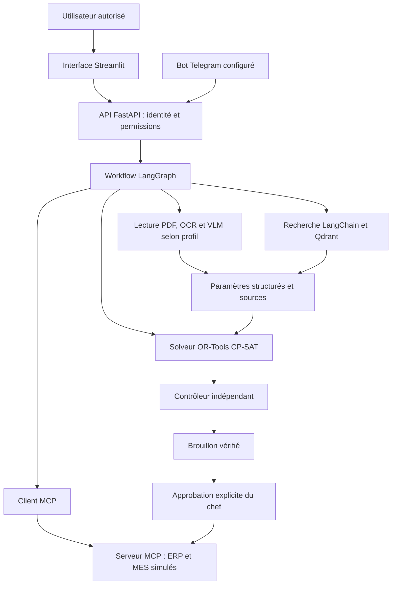

# OrdoPlan — Assistant d’ordonnancement multimodal et agentique

**Planifier la production, comprendre les contraintes et conserver une validation humaine.**

OrdoPlan est un prototype pédagogique destiné aux chefs d’atelier, planificateurs et responsables de production. Il exploite des documents et des données d’atelier pour construire un planning sous contraintes, puis le réorganiser lorsqu’une panne ou une commande urgente survient.

Le projet associe recherche documentaire, lecture de documents et d’images, optimisation, orchestration agentique et publication contrôlée dans un MES de démonstration.

> **Principe de conception :** le solveur calcule ; le contrôleur indépendant vérifie ; les sources justifient les paramètres ; le chef d’atelier approuve le contenu exact avant publication. Un modèle de langage ne décide jamais des dates ou de l’affectation des machines.

| Information | Description |
|---|---|
| Domaine | Ordonnancement d’un atelier de production fictif |
| Nature | Prototype pédagogique sur données synthétiques |
| Interface principale | Application web Streamlit |
| Backend | API FastAPI et services Python |
| Optimisation | OR-Tools CP-SAT et contrôleur Python indépendant |
| Exécution recommandée pour commencer | Docker Compose, profil compact CPU |
| Modèles tiers par API | Aucune API de modèle nécessaire |
| Coéquipier | **Oussama Kamil — [@oussamak05](https://github.com/oussamak05)** |
| Version technique documentée | Prototype v1.0.0 ; README enrichi le 23 novembre 2026 |

## Sommaire

1. [Contexte et objectifs](#contexte-et-objectifs)
2. [Équipe et répartition proposée](#équipe-et-répartition-proposée)
3. [Fonctionnalités et parcours utilisateur](#fonctionnalités-et-parcours-utilisateur)
4. [Architecture et responsabilités](#architecture-et-responsabilités)
5. [Modèle d’ordonnancement](#modèle-dordonnancement)
6. [Corpus, recherche documentaire et multimodalité](#corpus-recherche-documentaire-et-multimodalité)
7. [Profils CPU et IA locale](#profils-cpu-et-ia-locale)
8. [Installation et démarrage](#installation-et-démarrage)
9. [Démonstration reproductible](#démonstration-reproductible)
10. [Sécurité et validation humaine](#sécurité-et-validation-humaine)
11. [Tests, évaluation et résultats](#tests-évaluation-et-résultats)
12. [Structure du dépôt](#structure-du-dépôt)
13. [Jalons et livrables pédagogiques](#jalons-et-livrables-pédagogiques)
14. [Exploitation et dépannage](#exploitation-et-dépannage)
15. [Limites et perspectives](#limites-et-perspectives)
16. [Documentation, provenance et licences](#documentation-provenance-et-licences)

## Contexte et objectifs

Dans un atelier, les commandes ne peuvent pas être exécutées dans un ordre arbitraire. Certaines pièces nécessitent une machine particulière, un outillage partagé, une matière disponible à une heure donnée ou un opérateur. Un changement de famille de production entraîne un temps de réglage. Les échéances commerciales doivent être prises en compte sans ignorer ces contraintes physiques.

Lorsqu’une machine devient indisponible, le responsable doit déterminer quelles opérations peuvent être déplacées, quels engagements restent réalisables et quels retards deviennent inévitables. Les informations utiles sont souvent dispersées entre fiches machines, gammes, procédures, fichiers ERP et documents papier.

OrdoPlan répond à quatre objectifs :

- **Centraliser les informations utiles** et retrouver leurs sources documentaires.
- **Calculer un planning réalisable** dans le modèle de contraintes retenu.
- **Replanifier avec un impact mesurable**, en limitant les retards et les changements inutiles.
- **Préserver la responsabilité humaine**, en soumettant chaque publication à une approbation explicite.

Le projet ne pilote aucune machine et ne prend aucune décision de sécurité industrielle. Le MES et l’ERP utilisés pour la démonstration sont simulés.

### Termes métier

| Terme | Signification dans OrdoPlan |
|---|---|
| OF | Ordre de fabrication : travail à réaliser, avec quantité, durée, famille, échéance et priorité |
| CNC | Machine à commande numérique ; la démonstration principale utilise CNC-A et CNC-B |
| Gamme | Informations décrivant la fabrication et les paramètres nécessaires au calcul |
| Réglage | Temps de préparation de la machine entre deux familles de production |
| ERP | Système de gestion fournissant notamment les commandes ; ici, exports et service simulés |
| MES | Système de suivi de production recevant un planning approuvé ; ici, démonstrateur |
| Gantt | Représentation des opérations sur une ligne temporelle, par machine |
| RAG | Recherche de passages documentaires utilisés pour étayer une réponse |
| MCP | Protocole permettant à l’agent d’appeler des outils métier définis et contrôlés |


### Organisation de travail recommandée

Chaque évolution doit préciser le problème traité, les fichiers concernés, les vérifications effectuées et les limites restantes. Une modification des règles d’ordonnancement doit être relue par l’autre membre. Les deux membres doivent pouvoir expliquer le parcours complet, même lorsque leur responsabilité principale porte sur un seul sous-système.

Pour la soutenance, Oussama peut présenter le corpus, l’ingestion, la recherche documentaire et l’évaluation du reranker. L’autre membre peut présenter le besoin métier, le solveur, la replanification et le workflow de publication. La démonstration, la sécurité et les limites sont préparées ensemble.

## Fonctionnalités et parcours utilisateur

| Fonction | Entrée | Sortie ou comportement |
|---|---|---|
| Planning initial | Instance d’atelier et ordres de fabrication | Affectations, dates, Gantt et indicateurs |
| Replanification après panne | Machine, instant et durée confirmés | Planning révisé et comparaison avec la référence |
| Commande urgente | Nouvel OF et paramètres validés | Nouvelle proposition et retards recalculés |
| Question documentaire | Question en français et identité autorisée | Passages pertinents et références vérifiables |
| Import ERP | CSV ou Excel | Données structurées et contrôlées |
| Lecture de documents | PDF, photographie ou scan | Informations extraites ; clarification si nécessaire |
| Validation MES | Brouillon exact et approbation du chef | Publication versionnée dans le MES simulé |
| Historique | Publications accessibles | Consultation et préparation d’un retour arrière approuvé |
| Export | Planning affiché | Fichiers CSV et JSON |
| Messagerie | Compte Telegram associé | Accès complémentaire, après configuration et essai réel |

L’interface est organisée autour des onglets **Atelier & planning**, **Assistant documentaire**, **Documents & photos**, **Validation MES** et **Évaluation & guide**. Le parcours web fonctionne sans Telegram.

## Architecture et responsabilités



### Technologies principales

| Technologie | Rôle | Pourquoi elle est utilisée |
|---|---|---|
| Python 3.12 | Implémentation et scripts | Écosystème commun aux API, à l’optimisation et au traitement documentaire |
| FastAPI | API applicative | Services structurés, validation des échanges et documentation OpenAPI |
| Pydantic | Schémas de données | Validation des champs et contrats explicites entre composants |
| Streamlit et Plotly | Interface et Gantt | Démonstration interactive des données, plannings et comparaisons |
| OR-Tools CP-SAT | Optimisation | Modélisation des affectations, séquences, calendriers et ressources |
| LangGraph | Orchestration | Workflow avec états, interruption et reprise après approbation |
| LangChain | Chaîne de recherche | Composition du traitement documentaire |
| Qdrant | Index vectoriel | Recherche avec filtrage des métadonnées et des droits |
| PyMuPDF et Tesseract | Extraction PDF et OCR | Lecture locale des documents et scans |
| pandas et openpyxl | Imports ERP | Traitement des fichiers CSV et Excel |
| SDK MCP | Outils métier | Consultation et publication via un contrat contrôlé |
| SQLite et chiffrement applicatif | Persistance du prototype | Stockage local des brouillons, publications et états sensibles |
| MLflow | Suivi expérimental | Conservation des métriques et paramètres des essais |
| Docker Compose | Installation | Démarrage reproductible des services |

Le stockage du prototype utilise SQLite avec chiffrement des contenus sensibles. PostgreSQL et MinIO ne sont pas des services implémentés dans cette version, même s’ils constituent des options possibles dans le sujet.

### Flux de décision

1. Vérifier l’identité, l’atelier et les permissions.
2. Lire les entrées et valider les champs ; demander une confirmation en cas d’incertitude.
3. Retrouver les règles et conserver les références des paramètres.
4. Calculer une proposition avec CP-SAT.
5. Vérifier indépendamment les contraintes et recalculer les indicateurs.
6. Présenter les opérations et les changements dans un brouillon.
7. Attendre l’approbation explicite du contenu exact.
8. Publier par MCP, avec contrôles serveur et prévention des doublons.

## Modèle d’ordonnancement

### Hypothèses de modélisation

Chaque OF correspond à une opération non préemptive : une fois engagée, elle n’est pas découpée automatiquement en plusieurs segments. Les durées sont déterministes et exprimées en minutes entières depuis 08:00. Pour une gamme donnée, la durée reste identique sur les machines éligibles.

Le réglage occupe la machine immédiatement avant la production. Les outils et opérateurs sont réservés pendant la production seulement ; cette simplification doit être validée avant toute adaptation industrielle.

### Contraintes prises en compte

- Un OF est affecté exactement une fois, à une machine éligible.
- La durée de fabrication respecte la quantité et le temps unitaire de la gamme.
- Une machine ne traite pas simultanément deux blocs de réglage ou de production.
- Les changements de famille respectent la matrice de réglage.
- Les indisponibilités des machines, outils et opérateurs sont respectées.
- Un outil ou opérateur unique ne peut être utilisé par deux OF en même temps.
- La production ne commence pas avant la disponibilité matière.
- Les opérations engagées, y compris leur réglage, sont gelées lors d’une replanification.
- Les opérations futures respectent l’instant courant et l’horizon de calcul.

Dans le corpus de démonstration, **ALU vers ACIER nécessite 30 minutes**, **ACIER vers ALU 20 minutes** et une même famille ne nécessite pas de changement. Ces valeurs proviennent de `regles_reglage.pdf` ; elles ne sont pas des constantes universelles de fabrication.

### Objectifs, dans l’ordre de priorité

Le solveur utilise une optimisation lexicographique :

1. Minimiser le **retard pondéré** : somme des retards multipliés par les priorités.
2. En présence d’une référence, minimiser l’**instabilité** : décalages des débuts et pénalité de changement de machine.
3. Minimiser la **fin globale du planning**.

La pénalité de changement de machine vaut 60 minutes équivalentes dans la fonction de stabilité. Elle n’ajoute pas une heure de production réelle. Le budget global de résolution est borné à 20 secondes.

| Statut | Interprétation |
|---|---|
| `OPTIMAL` | Optimalité démontrée pour toutes les étapes de l’objectif, dans le modèle retenu |
| `FEASIBLE` | Solution réalisable trouvée, sans preuve complète d’optimalité |
| `INFEASIBLE` | Incompatibilité des contraintes démontrée par le solveur |
| Absence de solution dans le budget | Ne permet pas, seule, de conclure à une impossibilité mathématique |

### Contrôleur indépendant

`src/solver/checker.py` ne dépend pas d’OR-Tools. Il vérifie les affectations, les durées, les réglages, les chevauchements, les ressources, les indisponibilités et le gel des opérations. Il ne répare pas silencieusement une solution. Une violation bloque son utilisation dans le parcours de publication.

Le modèle détaillé est documenté dans [docs/modele_optimisation.md](docs/modele_optimisation.md).

## Corpus, recherche documentaire et multimodalité

### Données fournies

| Ensemble | Contenu |
|---|---|
| Corpus | 40 PDF synthétiques, avec pages visuelles et 87 passages structurés |
| Équipements documentés | Familles CNC et tours ; scénario principal centré sur deux CNC |
| Instances | 50 instances d’ordonnancement et une instance `demo` |
| Exports ERP | Commandes au format CSV et Excel |
| Images d’essai | Afficheur CNC-B, OF-109 papier, image illisible et tentative d’injection |
| Adaptation du reranker | 1 000 triplets synthétiques : question, passage positif et passage négatif |
| Évaluation fonctionnelle | 150 scénarios de composants |

Les données sont fictives. Les annotations ont fait l’objet de contrôles automatiques, sans validation experte industrielle.

### Ingestion et provenance

La lecture privilégie les exports structurés, puis la couche texte des PDF. L’OCR et, selon le profil, le VLM complètent les documents photographiés ou scannés. Les champs extraits sont contrôlés : quantité positive, référence connue, échéance plausible et cohérence avec la gamme.

Chaque passage conserve notamment l’identifiant du document, sa version, la page, l’élément, le texte, la famille ou la machine, l’atelier, les groupes autorisés et les chemins des ressources originales. Une citation peut ainsi être comparée au passage réellement accessible.

### Recherche et réponse sourcée

La recherche filtre les documents selon l’identité avant leur restitution, combine plusieurs classements, puis applique un reranking. La fusion utilise le principe de Reciprocal Rank Fusion : un passage bien classé dans plusieurs recherches reçoit un meilleur score combiné.

Dans le profil CPU, les vecteurs sont construits par hachage de fragments de caractères, complétés par une recherche lexicale et les descriptions des pages. **Ce mécanisme n’est pas un modèle neuronal d’embeddings.** Les réponses documentaires restituent des extraits vérifiés ; les explications chiffrées utilisent des résultats calculés et des formulations contrôlées.

### Adaptation du reranker

Le jeu est séparé **par document**, avec 600 exemples d’entraînement, 200 de validation et 200 de test. Cette séparation limite la présence des mêmes documents dans plusieurs partitions.

Le profil neuronal utilise un cross-encoder multilingue adapté sur ses deux dernières couches et sa tête de classification : 3 697 153 paramètres entraînables, une époque lors de l’essai documenté. L’adaptation est réelle, mais **aucun gain neuronal n’a été démontré sur le jeu fourni** : le modèle initial et le modèle adapté obtiennent les mêmes scores parfaits sur des questions faciles, souvent fondées sur les titres.

### Gestion de l’incertitude

Une photo illisible ou un désaccord entre OCR et VLM ne doit pas devenir une instruction de planification. Une machine arrêtée visible sur un afficheur ne fournit pas nécessairement une durée d’arrêt. L’application demande alors la donnée manquante et une confirmation humaine.

## Profils CPU et IA locale

| Élément | Démonstration CPU par défaut | Profil IA locale |
|---|---|---|
| Lecture | OCR local et validation | SmolVLM et OCR, avec confirmation en cas de désaccord |
| Recherche textuelle | Vecteurs de caractères et recherche lexicale | Embeddings multilingues |
| Recherche visuelle | Descriptions/OCR des pages | Encodeurs texte-image multilingues compatibles CLIP |
| Reranking | Petit modèle supervisé local | Cross-encoder multilingue adapté |
| Poids externes à installer | Aucun pour démarrer | Pack séparé ou provisionnement explicite |
| Calcul du planning | CP-SAT | CP-SAT |

Les modèles ouverts comprennent SmolVLM-256M-Instruct, un encodeur multilingue MiniLM, des encodeurs CLIP appariés et un reranker dérivé de `cross-encoder/mmarco-mMiniLMv2-L12-H384-v1`. Les identifiants et révisions exactes sont dans [models/models.lock.json](models/models.lock.json).

Qwen2.5-VL-7B constitue une cible possible du sujet, non un modèle évalué ici. Télécharger les poids ne suffit pas à activer le profil neuronal : les dépendances, chemins et variables doivent également être configurés. Les limites de transcription du VLM compact sont consignées dans les rapports.

## Installation et démarrage

### Prérequis pour Docker

- Docker Desktop démarré, avec Docker Compose disponible.
- Environ 4 Go de RAM disponibles pour commencer avec le profil compact.
- Au moins 10 Go d’espace disque pour l’installation et la construction ; davantage avec les modèles.
- Ports locaux 8000 et 8501 disponibles.
- Connexion Internet pour le téléchargement initial des images et dépendances.

Une fois provisionné, le profil CPU fonctionne localement. L’absence d’API de modèle n’implique pas une installation sans Internet. Telegram nécessite son service réseau externe.

### Démarrage recommandé sous Windows

Décompresser le projet, ouvrir le dossier contenant `docker-compose.compact.yml`, puis ouvrir PowerShell dans ce dossier.

```powershell
docker compose -f docker-compose.compact.yml up --build -d
docker compose -f docker-compose.compact.yml ps
```

Ouvrir :

- **Application :** http://localhost:8501
- **Documentation API :** http://localhost:8000/docs

| Compte | Usage | Mot de passe de démonstration |
|---|---|---|
| `chef` | Chef d’atelier : revue, approbation et publication | `OrdoPlan-demo-2026!` |
| `planif` | Préparation des propositions | `OrdoPlan-demo-2026!` |
| `lecture` | Consultation autorisée | `OrdoPlan-demo-2026!` |
| `chef2` | Identité d’un autre atelier pour les essais d’isolation | `OrdoPlan-demo-2026!` |

Ces identifiants sont publics et réservés à une démonstration locale. Le profil compact expose les ports sur `127.0.0.1` et conserve les données dans un volume Docker.

```powershell
# Consulter les journaux
docker compose -f docker-compose.compact.yml logs --tail 100 ordoplan

# Arrêter sans supprimer le volume
docker compose -f docker-compose.compact.yml down

# Redémarrer après un arrêt
docker compose -f docker-compose.compact.yml up -d
```

Docker Desktop doit rester démarré. PowerShell peut être fermé après un lancement détaché avec `-d`.

### Installation native avec Python

Python 3.12 est la version testée. Installer également Tesseract et les données linguistiques adaptées. Sous Linux, prévoir les paquets Tesseract français/anglais, les polices DejaVu et `libgomp1`.

```bash
python3.12 -m venv .venv
.venv/bin/python -m pip install -r requirements.txt
cp .env.example .env
.venv/bin/python scripts/run.py
```

Sous Windows, après installation de Python 3.12 et ajout de Tesseract au `PATH` :

```powershell
powershell -ExecutionPolicy Bypass -File scripts/install.ps1
.\run.bat
```

Le script de lancement démarre l’API sur 8000, MCP sur 8101 et Streamlit sur 8501. L’installation native Windows est fournie, mais n’a pas été exécutée dans l’environnement Linux des essais archivés.

### Services séparés

Le fichier principal distingue API, MCP, interface et Qdrant :

```bash
docker compose config --quiet
docker compose up --build -d
docker compose ps
```

Arrêter le profil compact avant de lancer une autre topologie utilisant les mêmes ports. Les vérifications du profil compact, de la configuration séparée et du profil neuronal ne sont pas interchangeables : consulter [le rapport de déploiement](docs/deploiement_verifie.md).

### Activer les modèles locaux

Placer les poids dans `models/vlm/`, `models/embedding/`, `models/reranker_adapted/`, `models/clip_text/` et `models/clip_image/`. Installer les dépendances neuronales dans l’environnement Python choisi :

```bash
.venv/bin/python -m pip install -r requirements-neural.txt
```

Pour un téléchargement explicite sans pack, puis une nouvelle adaptation du reranker :

```bash
.venv/bin/python -m scripts.download_models vlm embedding reranker clip_text clip_image
.venv/bin/python -m src.reranker.train_neural --epochs 1
```

Configurer ensuite les variables suivantes dans `.env` pour le lancement natif :

```dotenv
ORDOPLAN_MODEL_MODE=vlm
ORDOPLAN_VLM_PATH=models/vlm
ORDOPLAN_RETRIEVAL=semantic
ORDOPLAN_RERANKER=neural
ORDOPLAN_EMBEDDING_PATH=/chemin/absolu/ordoplan/models/embedding
ORDOPLAN_RERANKER_PATH=/chemin/absolu/ordoplan/models/reranker_adapted
ORDOPLAN_CLIP_TEXT_PATH=/chemin/absolu/ordoplan/models/clip_text
ORDOPLAN_CLIP_IMAGE_PATH=/chemin/absolu/ordoplan/models/clip_image
HF_HUB_OFFLINE=1
TRANSFORMERS_OFFLINE=1
HF_HUB_DISABLE_TELEMETRY=1
```

Remplacer les chemins d’exemple par les chemins réels. Les variables hors ligne s’activent après provisionnement des modèles. Le fichier compact ne monte pas automatiquement ces poids et n’active pas ce profil.

Pour la topologie neuronale Compose, après préparation des poids et construction de l’image de base :

```bash
docker compose -f docker-compose.yml -f docker-compose.neural.yml up --build -d
```

Prévoir au moins 8 Go de RAM disponibles. Le démarrage à froid des modèles est plus lent qu’une requête à chaud. Voir [le guide d’installation](docs/installation.md) pour les détails et l’état réel des essais.

### Telegram

Le bot est une interface complémentaire, utilisable aussi depuis Telegram Desktop ou Web. Aucun téléphone n’est nécessaire au fonctionnement du projet web.

Pour l’activer, créer un bot auprès de BotFather, renseigner `TELEGRAM_BOT_TOKEN` et un `TELEGRAM_BRIDGE_SECRET` aléatoire dans `.env`, puis utiliser le profil Telegram de la topologie principale. Le même secret de liaison doit être connu de l’API et du bot. Ne pas lancer cette topologie en parallèle du profil compact sur les mêmes ports.

```bash
docker compose --profile telegram up --build -d
```

Depuis l’application web, créer un code d’association puis envoyer `/link CODE` en conversation privée au bot. Ce code est utilisable une seule fois et expire après cinq minutes. Les droits du compte applicatif restent contrôlés côté serveur.

Les commandes comprennent `/ask`, `/plan`, `/breakdown`, `/urgent`, `/history`, `/orders`, `/draft`, `/approve`, `/publish`, `/cancel` et `/unlink`. Le code et les contrôles d’identité sont livrés ; une conversation Telegram réelle reste à vérifier avec un jeton personnel. La feuille de route prévoit un client de messagerie au dernier jalon : son caractère non nécessaire au démarrage web ne remplace pas cette validation pédagogique.

## Démonstration reproductible

### 1. Calculer le planning initial

Se connecter avec `chef`, ouvrir **Atelier & planning**, conserver `demo`, puis cliquer sur **Calculer le planning initial**. Examiner le Gantt, le tableau des OF et les indicateurs.

### 2. Simuler une panne

Dans **Replanifier après un aléa**, sélectionner CNC-B, un début à **240 minutes après 08:00**, soit 12:00, et une durée de **180 minutes**. Confirmer les informations puis recalculer. Cette frontière correspond au scénario livré et évite d’interrompre une opération déjà engagée dans le planning de référence.

### 3. Ajouter une urgence

À partir du planning replanifié, sélectionner la commande urgente **OF-109** à l’instant 240, confirmer et recalculer. Conserver la référence issue de la panne pour démontrer l’enchaînement des événements.

| Étape du parcours archivé | OF en retard | Retard pondéré | Fin du planning |
|---|---:|---:|---|
| Initial | 0 | 0 min | 13:30 |
| Après panne | 0 | 0 min | 15:30 |
| Après urgence | 2 | 60 min | 16:30 |

Dans le dernier cas, OF-105 et OF-104 présentent chacun 30 minutes de retard. Ces résultats concernent les données et versions livrées ; ils ne sont pas garantis pour une autre instance ou une autre séquence d’événements.

### 4. Approuver et publier

Ouvrir **Validation MES**, vérifier les opérations et le contenu exact du brouillon, cocher la confirmation, cliquer sur **Approuver ce contenu**, puis sur **Publier dans le MES**. Vérifier la version créée dans l’historique. Le MES est simulé : cette action ne commande aucun équipement.

### 5. Montrer les sources et les incertitudes

Dans **Assistant documentaire**, poser : « Quel est le temps de changement de série ALU vers ACIER ? ». Vérifier les 30 minutes et la référence `regles_reglage`, page 1.

Dans **Documents & photos**, essayer `afficheur_cnc_b.png`, `ordre_OF_109.png`, `illisible.png` et `injection.png`. Montrer qu’un champ inconnu conduit à une clarification plutôt qu’à une publication automatique.

Le [scénario détaillé](docs/demonstration.md) propose une démonstration de 10 à 12 minutes et des questions de soutenance.

## Sécurité et validation humaine

Les documents, photos et textes importés sont traités comme des données non fiables. Une instruction contenue dans un document ne doit pas modifier les permissions ou déclencher une publication.

| Mécanisme | Finalité |
|---|---|
| Authentification et rôles | Distinguer consultation, préparation et approbation |
| Filtrage par atelier | Empêcher la restitution de documents d’un autre atelier |
| Sessions opaques et mots de passe hachés | Éviter le stockage de mots de passe en clair |
| Chiffrement des contenus sensibles | Protéger les brouillons, publications et checkpoints locaux |
| Approbation liée au contenu exact | Empêcher la substitution d’un planning après accord |
| Expiration de l’approbation | Limiter la validité du jeton à cinq minutes |
| Contrôle de révision | Bloquer une publication fondée sur une référence devenue obsolète |
| Idempotence | Éviter les doublons lors d’une nouvelle tentative de publication |
| Budgets d’exécution | Borner les appels et la durée du workflow |

L’approbation est associée à une empreinte canonique du contenu, à l’utilisateur, à son atelier, à son rôle et à la révision concernée. La publication est transactionnelle. Un retour arrière prépare une nouvelle action soumise à validation ; il ne contourne pas le contrôle humain.

Les budgets prévus sont de trois appels MCP, six appels de modèle et 60 secondes pour le workflow, avec un budget de résolution distinct borné à 20 secondes. Ces bornes ne sont pas des promesses de latence pour toutes les machines.

Les détails sont dans [docs/securite.md](docs/securite.md). Le prototype ne doit pas être exposé sur Internet avec ses comptes de démonstration.

## Tests, évaluation et résultats

### Commandes de vérification

Depuis la racine du projet, dans l’environnement Python équipé des dépendances :

```bash
.venv/bin/python -m pip install -r requirements-dev.txt
.venv/bin/python -m pytest -q
.venv/bin/python -m scripts.ingest --verify
.venv/bin/python -m scripts.evaluate
.venv/bin/python -m src.reranker.evaluate_reranker
.venv/bin/python -m scripts.scan_secrets
```

Pour exercer le parcours HTTP/MCP, démarrer préalablement les services :

```bash
.venv/bin/python -m scripts.demo_end_to_end
```

Sous Windows natif, utiliser `.venv\Scripts\python.exe` à la place de `.venv/bin/python`.

### Résultats archivés

La version livrée comprend un rapport de **68 tests réussis** et **150 scénarios de composants réussis**. Ces résultats sont ceux des essais archivés ; la modification de ce README ne constitue pas une nouvelle exécution de ces tests.

| Catégorie des scénarios | Nombre |
|---|---:|
| Lecture | 30 |
| Recherche documentaire | 20 |
| Ordonnancement | 30 |
| Replanification | 25 |
| MCP | 10 |
| Incertitude | 10 |
| Approbation | 10 |
| Injection | 15 |
| **Total** | **150** |

Les essais de composants, le transport HTTP/MCP réel, l’interface et les modèles neuronaux sont documentés séparément. Le nombre de scénarios ne correspond pas à 150 conversations Telegram ou à 150 essais industriels.

### Mesures documentaires

- **Recall@5** : présence du passage pertinent parmi les cinq premiers résultats.
- **nDCG@5** : qualité de l’ordre des cinq premiers résultats selon leur pertinence.
- **MRR@10** : rang du premier résultat pertinent parmi les dix premiers.

Les scores parfaits du cross-encoder initial et adapté ne démontrent pas une généralisation industrielle. Un corpus réel, des questions plus ambiguës et une validation experte sont nécessaires pour conclure sur l’intérêt du fine-tuning.

### Dossier de preuves

| Fichier | Contenu |
|---|---|
| [reports/unit-tests.xml](reports/unit-tests.xml) | Résultats détaillés des tests |
| [reports/evaluation.json](reports/evaluation.json) | Scénarios de composants et résultats |
| [reports/end_to_end.json](reports/end_to_end.json) | Parcours intégré et opérations calculées |
| [reports/retrieval_metrics.json](reports/retrieval_metrics.json) | Comparaison des recherches légères |
| [reports/neural_reranker_metrics.json](reports/neural_reranker_metrics.json) | Comparaison neuronale avant/après adaptation |
| [reports/vlm_smoke.json](reports/vlm_smoke.json) | Essai du modèle visuel et limites observées |
| [docs/deploiement_verifie.md](docs/deploiement_verifie.md) | Portée des vérifications de déploiement |

Les audits de dépendances décrivent les vulnérabilités connues au moment de leur exécution. Ils doivent être renouvelés lorsque les dépendances ou les bases de vulnérabilités évoluent.

### Suivi expérimental et intégration continue

`python -m scripts.log_experiments` enregistre les métriques dans MLflow. Le profil `tracking` permet d’exposer le service local sur le port 5000. Les journaux expérimentaux ne remplacent pas les rapports de validation métier.

Le workflow [.github/workflows/ci.yml](.github/workflows/ci.yml) prévoit les tests, l’évaluation, le contrôle de secrets et l’audit des dépendances. Les dépendances directes figurent dans `requirements.in` et les versions figées dans les fichiers de verrouillage.

## Structure du dépôt

```text
OrdoPlan/
├── README.md                       # Présentation et point d’entrée
├── src/
│   ├── agent/                      # Workflow LangGraph
│   ├── api/                        # Services FastAPI
│   ├── auth/                       # Identités et permissions
│   ├── bot/                        # Interface Telegram
│   ├── ingestion/                  # PDF, OCR et imports ERP
│   ├── llm/                        # Lecture locale selon le profil
│   ├── mcp_server/                 # Serveur et client MCP
│   ├── rag/                        # Recherche et références
│   ├── reranker/                   # Classement, entraînement et évaluation
│   ├── schemas/                    # Modèles de données Pydantic
│   ├── solver/                     # CP-SAT et contrôleur indépendant
│   └── ui/                         # Interface Streamlit
├── data/                           # Corpus, instances, ERP et jeux d’essai
├── models/                         # Modèle léger et révisions ; poids séparés
├── prompts/                        # Prompts versionnés
├── configs/                        # Configuration et compatibilité de structure
├── scripts/                        # Installation, lancement et évaluations
├── tests/                          # Tests automatisés
├── reports/                        # Résultats et preuves archivés
├── docs/                           # Guides et dossiers techniques
├── .github/workflows/              # Intégration continue
├── docker-compose.compact.yml      # Démarrage local recommandé
├── docker-compose.yml              # Topologie à services séparés
├── docker-compose.neural.yml       # Complément pour les modèles locaux
├── Dockerfile                      # Image de démonstration
├── requirements.txt                # Installation du profil de base
├── requirements-neural.txt         # Dépendances des modèles
└── .env.example                    # Exemple de configuration
```

Les fichiers `.runtime/`, secrets et jetons appartiennent à l’exécution locale et ne doivent pas être ajoutés au dépôt. Les poids volumineux sont distribués séparément du projet léger.

## Jalons et livrables pédagogiques

La feuille de route MAINTiDOC sert de découpage pédagogique. Son domaine maintenance est adapté à OrdoPlan : les tickets deviennent des brouillons de publication de planning, avec maintien du contrôle humain.

| Jalon | Périmètre adapté | Livrables |
|---|---|---|
| 1 · Socle documentaire | Cadrage, ingestion, index, API, assistant textuel et tests d’accès | L1.1 à L1.6 |
| 2 · Multimodalité | Images, recherche multimodale, données d’adaptation et comparaison du reranker | L2.1 à L2.6 |
| 3 · Agentique | LangGraph, MCP, brouillons, approbation et parcours intégré | L3.1 à L3.6 |
| 4 · Intégration | Client de messagerie, sécurité, déploiement, évaluation et soutenance | L4.1 à L4.7 |

Le premier jalon peut être présenté comme le premier quart du découpage en quatre étapes. Cette convention de « 25 % » n’est ni une mesure du temps réellement passé ni la pondération officielle : la feuille de route affecte 20 % de la note à l’étape 1.

La [matrice de conformité](docs/matrice_conformite.md) précise les fichiers, preuves et écarts. Les notes hebdomadaires sont une organisation pédagogique du contenu, sans affirmation d’un historique de développement sur six semaines effectivement observées.

## Exploitation et dépannage

### Sauvegarde

Conserver ensemble la base, les checkpoints et `storage.key`. La perte de la clé rend les données chiffrées illisibles. Une sauvegarde cohérente nécessite l’arrêt des services concernés ou une procédure de sauvegarde SQLite adaptée.

`docker compose ... down` conserve les volumes. L’option `-v` les supprime : elle ne doit servir qu’à une réinitialisation volontaire. Éviter de réinitialiser l’environnement avant une soutenance sans sauvegarde des éléments utiles.

### Problèmes courants

| Symptôme | Vérification ou action |
|---|---|
| L’application ne s’ouvre pas | Vérifier Docker Desktop, `compose ps` et les journaux ; attendre la fin du premier démarrage |
| Port déjà utilisé | Vérifier qu’une autre instance native ou Compose n’occupe pas 8000/8501 |
| `python` absent sous Windows | Vérifier Python 3.12 ou utiliser le parcours Docker |
| OCR indisponible en natif | Vérifier Tesseract, son `PATH` et les données linguistiques |
| Panne déclarée infaisable | Examiner le chevauchement avec une opération ou un réglage gelé |
| Lecture de photo incomplète | Confirmer les champs demandés ; vérifier la qualité de l’image |
| Sources absentes ou accès refusé | Vérifier le rôle et l’atelier du compte |
| Approbation expirée | Relire le brouillon puis demander une nouvelle approbation |
| Révision devenue obsolète | Repartir de la référence courante avant de publier |
| Modèles téléchargés mais mode OCR toujours affiché | Vérifier les dépendances, variables et montages du profil neuronal |
| Telegram ne répond pas | Vérifier le service, le jeton, le réseau et l’association du compte |

## Limites et perspectives

Le projet démontre une chaîne cohérente sur un atelier fictif. Il ne constitue pas un système industriel qualifié.

- **Données synthétiques :** absence de validation terrain et d’entretien industriel effectivement réalisé.
- **Modèle simplifié :** une opération par OF, durées déterministes, atelier mono-site.
- **Panne pendant une opération engagée :** pas de suspension/reprise automatique ; l’incompatibilité est signalée.
- **Ressources pendant les réglages :** outils et opérateurs réservés seulement pendant la production dans le modèle actuel.
- **Lecture visuelle :** transcription parfois incomplète avec le VLM compact ; confirmation humaine indispensable.
- **Évaluation documentaire :** jeu facile, annotations non validées par un expert et absence de gain neuronal démontré.
- **Intégrations :** MES/ERP simulés ; pas d’intégration à un système de production réel.
- **Telegram :** code livré, connexion réelle à vérifier avec le jeton du propriétaire.
- **Déploiement :** les essais du profil compact ne qualifient pas automatiquement toutes les topologies ni tous les matériels.

Les priorités d’évolution sont la validation des règles avec un atelier, un corpus réel autorisé, les gammes multi-opérations, la gestion explicite des interruptions, un jeu d’évaluation plus exigeant et une architecture d’identité/persistance adaptée à plusieurs utilisateurs industriels.

## Documentation, provenance et licences

| Besoin | Document |
|---|---|
| Comprendre le cadrage | [Cadrage et architecture](docs/cadrage_et_architecture.md) |
| Installer et configurer | [Installation](docs/installation.md) |
| Utiliser l’application | [Guide utilisateur](docs/guide_utilisateur.md) |
| Comprendre les contraintes | [Modèle d’optimisation](docs/modele_optimisation.md) |
| Examiner les protections | [Sécurité](docs/securite.md) |
| Lire les résultats | [Résultats observés](docs/resultats_observes.md) |
| Reproduire l’évaluation | [Protocole d’évaluation](docs/evaluation_protocole.md) |
| Préparer la présentation | [Démonstration et soutenance](docs/demonstration.md) |
| Vérifier les limites | [Fiche de limites](docs/fiche_de_limites.md) |
| Suivre les livrables | [Matrice de conformité](docs/matrice_conformite.md) |

Le projet reprend l’organisation générale du dépôt d’exemple fourni : agent, API, authentification, ingestion, LLM, MCP, reranker, schémas et interface. Les modules métier d’ordonnancement sont propres à OrdoPlan. Aucun résultat automobile du dépôt d’exemple n’est présenté comme un résultat d’OrdoPlan.

Consulter [LICENSE](LICENSE), [NOTICE.md](NOTICE.md) et l’inventaire des licences dans `reports/`. Les bibliothèques et modèles conservent leurs licences respectives ; la disponibilité publique des poids n’annule pas leurs conditions d’utilisation. Le fichier de licence existant doit être pris en compte lors de toute redistribution.

**Contact du coéquipier : [Oussama Kamil — @oussamak05](https://github.com/oussamak05).** La répartition proposée ci-dessus doit être validée et complétée avec l’identité de l’autre membre avant une remise définitive attribuant les contributions.
