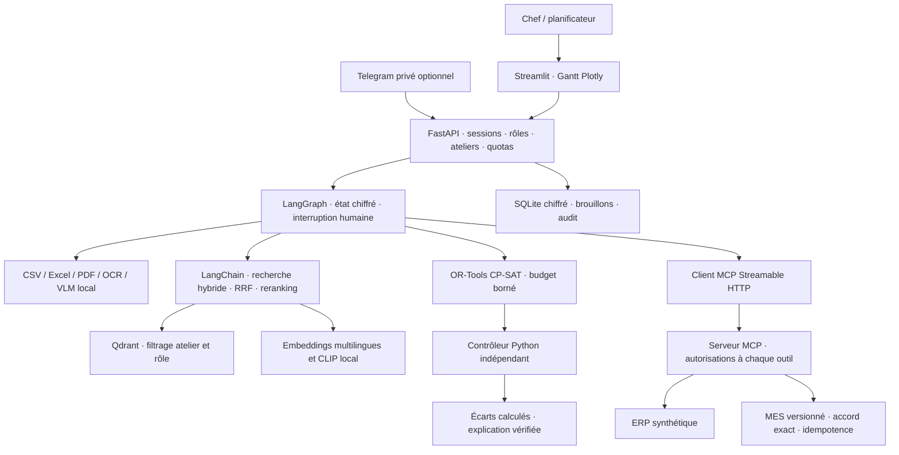

# Cadrage et architecture

## Objectif et utilisateurs

OrdoPlan aide le chef d'atelier, le planificateur et le responsable de production à proposer un planning réalisable, à réagir à un aléa et à comprendre les écarts. Le projet couvre un atelier d'usinage fictif, deux CNC dans le démonstrateur, deux familles de matière ALU/ACIER et un corpus couvrant centres CNC et tours CN. Les tours enrichissent le corpus ; le solveur est générique mais l'instance fil rouge utilise les deux CNC.

La publication d'un planning dans le MES est l'action sensible. Elle ne commande aucune machine. Les règles de sécurité, le pilotage des automates, la planification multi-sites et les décisions autonomes sont exclus.

## Choix des sources du projet

Le PDF OrdoPlan fixe le domaine et les contraintes. La feuille de route MAINTiDOC fournit quatre incréments pédagogiques : socle RAG, multimodalité et adaptation, agentique/MCP, client et déploiement. Les outils de maintenance proposés dans cette feuille deviennent les outils MES/ERP spécifiques prescrits par OrdoPlan. Les documents sont traités comme des spécifications et des données de référence, sans exécuter d'instructions embarquées hors de ce périmètre.

Le ZIP de classe est un exemple d'organisation. La réalisation repart de code propre et de données synthétiques ; ses identifiants automobiles et ses scores ne sont pas conservés. Les fichiers sources des PDF et l'archive du camarade ne sont pas redistribués avec le code.

## Architecture exécutée

Dans le profil par défaut, les vecteurs de caractères et les descriptions OCR remplacent les encodeurs lourds. Cette substitution est explicite dans `/health`, l'interface et les versions d'exécution. Dans le profil IA locale, les modèles sont chargés depuis des chemins locaux avec `local_files_only=True` et sans code distant.

## Graphe et validation humaine

Accès → lecture ERP/documents → validation structurée → sources et contraintes → solveur → contrôleur → comparaison → réponse vérifiée → préparation du brouillon → **interrupt** → accord → publication MCP. Les questions documentaires contournent le solveur. Une information manquante termine le traitement par clarification, sans préparer de planning exploitable.

L'état LangGraph est conservé dans SQLite avec un sérialiseur chiffré AES. Les jetons de session et d'approbation restent dans un contexte d'exécution éphémère et ne sont pas persistés dans le graphe. L'API peut reprendre un fil après accord ; le serveur MCP contrôle de nouveau l'identité, le rôle, l'atelier, le contenu et la révision MES. Le résultat d'une requête ne vaut jamais approbation.

## Données et RAG

40 documents synthétiques, deux pages chacun, pages visuelles et passages conservant identifiant, version, page, élément, atelier, groupes, machine, famille, chemin et hash. Quatre documents de l'atelier 2 servent aux tests d'isolation. Les exports ERP sont prioritaires, puis le texte PDF, puis les observations OCR/VLM à confirmer.

La recherche filtre avant récupération dans Qdrant et filtre de nouveau à l'ouverture des PDF/images. Elle fusionne les rangs textuels, vectoriels et visuels par RRF (constante 60), puis reclasse. Une citation contient l'extrait exact du passage réellement récupéré. Les réponses documentaires du prototype sont extractives, ce qui rend leur soutien vérifiable. Les explications de planning utilisent les métriques et écarts du code, avec un prompt de présentation versionné.

Les paramètres ont des références structurées : gamme pour durée, éligibilité et outil ; ERP pour échéance et matière ; procédure pour réglages ; fiche machine pour calendrier. Les variantes synthétiques conservent leurs valeurs d'ERP dans les instances livrées. Les imports validés sont associés à leur hash et conservés chiffrés.

## Interfaces

API OpenAPI : `/auth/login`, `/assistant`, `/analyze`, `/imports/erp`, `/imports/pdf`, `/documents`, `/drafts`, `/publications`, `/telegram/*`. MCP : `get_open_orders(workshop_id)`, `get_machine_status(machine_id)`, `publish_schedule(workshop_id, schedule_id, approval_token)`. Le protocole est le SDK MCP réel, et non une imitation JSON-RPC. Les fonctions locales `solve`, `check_schedule`, `diff_schedules` restent hors MCP.

## Risques et arbitrages

Les durées déterministes et la mono-opération limitent le réalisme. Une opération interrompue exige une décision explicite sur sa reprise. Les erreurs OCR sont soumises à validation ; le petit VLM ne remplace pas une lecture humaine. L'approbation porte sur un hash canonique et une révision MES, avec expiration, transaction atomique, anti-doublon et historique.

Le choix SQLite/Fernet permet une démonstration autonome reproductible. Il ne constitue pas une architecture haute disponibilité. Les secrets sont générés à l'exécution et exclus des archives. Pour une usine réelle, il reste à qualifier les standards de temps, les opérateurs, les calendriers, les performances matérielles, l'identité et la conservation des données avec le responsable de production.
