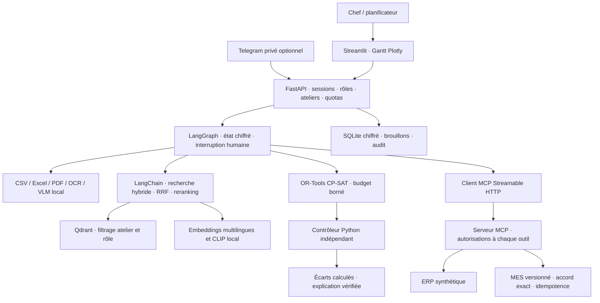

# Rapport de réalisation — OrdoPlan

Projet intégrateur d'IA générative multimodale et agentique. Version livrée 1.0.0, 16 novembre 2026.

## Résumé exécutif

OrdoPlan est un prototype fonctionnel d'aide à l'ordonnancement d'un atelier fictif. Il lit un carnet ERP, consulte des documents autorisés, calcule un planning par CP-SAT, vérifie indépendamment les contraintes, explique les écarts et interrompt le workflow avant toute publication MES. La décision d'ordonnancement appartient au solveur. La lecture documentaire et les observations visuelles n'accordent jamais d'autorisation de publication.

La réalisation couvre API FastAPI, Streamlit/Plotly, LangChain/LangGraph, véritable serveur et client MCP v2, Qdrant, OCR local, VLM ouvert, encodeurs multilingues/CLIP, adaptation réelle d'un cross-encoder, approbation liée au contenu, versions MES et retour arrière. Deux profils permettent un démarrage léger et une expérimentation complète des modèles locaux. Le bot Telegram et son association d'identité sont fournis ; son activation réelle requiert les secrets personnels du propriétaire.

Le dépôt contient 40 PDF synthétiques et 87 passages, 50 instances plus le fil rouge, des CSV/Excel et images, 1 000 triplets séparés par document et 150 scénarios. Les documents industriels, entretiens terrain et annotations expertes n'ont pas été inventés. Les choix et écarts au sujet sont détaillés dans la matrice de conformité et la fiche de limites.

## Vérifications observées

- 68 tests unitaires et API réussis dans la suite finale.
- 150/150 scénarios de composants réussis ; 0 contrainte violée dans les 30 plannings de référence.
- Retard pondéré inférieur ou égal à FIFO et EDD dans respectivement 30 et 30 cas sur 30.
- Replanification : p95 du solveur 0.127 s sur 25 aléas synthétiques.
- Les temps de composants ont une médiane de 0.090 s et un p95 de 0.359 s ; ce ne sont pas des latences multi-utilisateurs de production.
- Parcours HTTP + MCP réel réussi, approbation et réessai idempotent vérifiés. Latence p95 de ce parcours de requêtes : 0.298 s dans les conditions décrites dans le JSON.
- Embeddings multilingues + CLIP + reranker adapté essayés localement ; le VLM compact a produit des transcriptions insuffisantes et le système maintient la validation humaine.
- Les audits finaux du socle et de l'environnement complet ne signalent pas de vulnérabilité connue au moment de leur exécution ; la CI doit continuer ces contrôles.

## Lecture de ces résultats

L'adaptation du cross-encoder a réellement entraîné 3,697,153 paramètres pendant 288.7 s sur CPU, une époque, 600 triplets. nDCG@5 et MRR@10 sont identiques avant/après (1.000 et 1.000 pour nDCG@5). Aucun gain neuronal n'est démontré. Le jeu à titres explicites manque de difficulté et ne permet pas de généraliser à l'atelier réel.

La suite de 150 cas comprend 10 images OCR, des exports, PDF et rejets, et non 30 lectures VLM de photos industrielles. Les tests du transport, du navigateur et des modèles sont séparés et accompagnés de preuves. Le matériel GPU de 24 Go n'a pas été évalué.


# Cadrage et architecture

## Objectif et utilisateurs

OrdoPlan aide le chef d'atelier, le planificateur et le responsable de production à proposer un planning réalisable, à réagir à un aléa et à comprendre les écarts. Le projet couvre un atelier d'usinage fictif, deux CNC dans le démonstrateur, deux familles de matière ALU/ACIER et un corpus couvrant centres CNC et tours CN. Les tours enrichissent le corpus ; le solveur est générique mais l'instance fil rouge utilise les deux CNC.

La publication d'un planning dans le MES est l'action sensible. Elle ne commande aucune machine. Les règles de sécurité, le pilotage des automates, la planification multi-sites et les décisions autonomes sont exclus.

## Choix des sources du projet

Le PDF OrdoPlan fixe le domaine et les contraintes. La feuille de route MAINTiDOC fournit quatre incréments pédagogiques : socle RAG, multimodalité et adaptation, agentique/MCP, client et déploiement. Les outils de maintenance proposés dans cette feuille deviennent les outils MES/ERP spécifiques prescrits par OrdoPlan. Les documents sont traités comme des spécifications et des données de référence, sans exécuter d'instructions embarquées hors de ce périmètre.

Le ZIP de classe est un exemple d'organisation. La réalisation repart de code propre et de données synthétiques ; ses identifiants automobiles et ses scores ne sont pas conservés. Les fichiers sources des PDF et l'archive du camarade ne sont pas redistribués avec le code.

## Architecture exécutée



Dans le profil par défaut, les vecteurs de caractères et les descriptions OCR remplacent les encodeurs lourds. Cette substitution est explicite dans `/health`, l'interface et les versions d'exécution. Dans le profil IA locale, les modèles sont chargés depuis des chemins locaux avec `local_files_only=True` et sans code distant.

## Graphe et validation humaine

Accès → lecture ERP/documents → validation structurée → sources et contraintes → solveur → contrôleur → comparaison → réponse vérifiée → préparation du brouillon → **interrupt** → accord → publication MCP. Les questions documentaires contournent le solveur. Une information manquante termine le traitement par clarification, sans préparer de planning exploitable.

L'état LangGraph est conservé dans SQLite avec un sérialiseur chiffré AES. Les jetons de session et d'approbation restent dans un contexte d'exécution éphémère et ne sont pas persistés dans le graphe. L'API peut reprendre un fil après accord ; le serveur MCP contrôle de nouveau l'identité, le rôle, l'atelier, le contenu et la révision MES. Le résultat d'une requête ne vaut jamais approbation.

## Données et RAG

40 documents synthétiques, deux pages chacun, pages visuelles et passages conservant identifiant, version, page, élément, atelier, groupes, machine, famille, chemin et hash. Quatre documents de l'atelier 2 servent aux tests d'isolation. Les exports ERP sont prioritaires, puis le texte PDF, puis les observations OCR/VLM à confirmer.

La recherche filtre avant récupération dans Qdrant et filtre de nouveau à l'ouverture des PDF/images. Elle fusionne les rangs textuels, vectoriels et visuels par RRF (constante 60), puis reclasse. Une citation contient l'extrait exact du passage réellement récupéré. Les réponses documentaires du prototype sont extractives, ce qui rend leur soutien vérifiable. Les explications de planning utilisent les métriques et écarts du code, avec un prompt de présentation versionné.

Les paramètres ont des références structurées : gamme pour durée, éligibilité et outil ; ERP pour échéance et matière ; procédure pour réglages ; fiche machine pour calendrier. Les variantes synthétiques conservent leurs valeurs d'ERP dans les instances livrées. Les imports validés sont associés à leur hash et conservés chiffrés.

## Interfaces

API OpenAPI : `/auth/login`, `/assistant`, `/analyze`, `/imports/erp`, `/imports/pdf`, `/documents`, `/drafts`, `/publications`, `/telegram/*`. MCP : `get_open_orders(workshop_id)`, `get_machine_status(machine_id)`, `publish_schedule(workshop_id, schedule_id, approval_token)`. Le protocole est le SDK MCP réel, et non une imitation JSON-RPC. Les fonctions locales `solve`, `check_schedule`, `diff_schedules` restent hors MCP.

## Risques et arbitrages

Les durées déterministes et la mono-opération limitent le réalisme. Une opération interrompue exige une décision explicite sur sa reprise. Les erreurs OCR sont soumises à validation ; le petit VLM ne remplace pas une lecture humaine. L'approbation porte sur un hash canonique et une révision MES, avec expiration, transaction atomique, anti-doublon et historique.

Le choix SQLite/Fernet permet une démonstration autonome reproductible. Il ne constitue pas une architecture haute disponibilité. Les secrets sont générés à l'exécution et exclus des archives. Pour une usine réelle, il reste à qualifier les standards de temps, les opérateurs, les calendriers, les performances matérielles, l'identité et la conservation des données avec le responsable de production.


# Modèle d'optimisation et contrôleur

## Hypothèses

Une opération non préemptive par OF. La quantité multiplie le temps unitaire connu. Une gamme conserve la même durée sur ses machines éligibles. Les dates sont des minutes entières depuis 08:00 dans un horizon borné. Les échéances sont souples et les disponibilités matière sont des bornes dures. Les réglages occupent la machine immédiatement avant la production, sans interruption ; les outils et opérateurs sont réservés pendant la production seulement.

Les familles ALU/ACIER commandent les changements : 30 minutes ALU→ACIER, 20 minutes ACIER→ALU, zéro pour une même famille. Les valeurs sont sourcées dans `regles_reglage.pdf`. Un autre atelier doit fournir sa propre matrice complète ; une transition absente est rejetée.

## Variables

Pour chaque OF i : début s_i, fin e_i, durée p_i = quantité_i × temps_unitaire_i. Pour chaque machine éligible m : x_im binaire de sélection ; réglage g_im ; début du bloc b_im = s_i − g_im ; intervalle optionnel [b_im,e_i[ de taille p_i+g_im. Pour chaque arc consécutif i→j sur m : a_ijm binaire. Un nœud fictif représente le premier et dernier OF.

## Contraintes

1. Somme_m x_im = 1 et e_i = s_i+p_i. Les machines non éligibles n'ont aucune variable d'affectation.
2. `AddCircuit` impose une séquence par machine. Un OF non sélectionné possède une boucle sur lui-même.
3. Un arc i→j impose s_j ≥ e_i + changement(f_i,f_j) et g_jm égal au changement. Le premier OF utilise la famille initiale de la machine.
4. `NoOverlap` sur les blocs de production/réglage et les indisponibilités machine. Le réglage ne traverse donc pas une panne ou une maintenance.
5. `NoOverlap` sur les intervalles de production des OF partageant un outil unique ou un opérateur, et sur leurs absences.
6. s_i ≥ réception_matière_i. Pour une opération future, b_im ≥ instant_courant. Les opérations déjà commencées, y compris un réglage engagé, sont gelées exactement.
7. 0 ≤ b_im ≤ s_i < e_i ≤ horizon. Les OF gelés conservent machine, début, fin et réglage.

## Objectif lexicographique

T = somme_i poids_i × max(0,e_i−échéance_i).

D = somme_i déjà planifiés |s_i−ancien_début_i| + 60 × indicatrice(machine changée).

C = max_i e_i.

Résoudre successivement min T, min D si une référence existe, puis min C. Chaque étape fixe une borne supérieure à la meilleure valeur précédente. Le budget global de résolution est borné à 20 secondes, partagé entre les étapes. Le coefficient 60 est une pénalité de stabilité en minutes équivalentes, pas un temps physique ajouté à la production.

`OPTIMAL` n'est affiché que si toutes les étapes aboutissent avec preuve d'optimalité. Si une étape fournit seulement une solution réalisable ou qu'une étape suivante manque de temps, l'état est `FEASIBLE`. La borne primaire est conservée ; l'absence de solution après un budget court n'est pas qualifiée d'infaisabilité démontrée. `INFEASIBLE` est réservé à la preuve du solveur.

## Contrôleur indépendant

`src/solver/checker.py` n'importe pas OR-Tools. Il vérifie couverture unique des OF, éligibilité, durée, réglage selon la séquence triée, absence de chevauchement, indisponibilités, ressources uniques, disponibilités matière, instant courant, horizon et gel. Il ne modifie aucune solution. Une violation bloque la présentation et la publication.

Les métriques et les écarts sont recalculés en Python depuis les opérations. Les affirmations chiffrées de l'explication viennent uniquement de ces objets. Les tests corrompent volontairement une durée, une machine, un réglage, une ressource et un gel pour vérifier que le contrôleur détecte chaque classe d'erreur.

## Références et impossibilités

FIFO trie par disponibilité et identifiant ; EDD trie par échéance, puis place chaque opération au plus tôt sur une machine réalisable. Elles respectent le même contrôleur. Une référence manuelle fixe une séquence issue de la démo et place ses tâches de manière série ; ce n'est pas une expertise industrielle.

Une panne qui chevauche une opération gelée rend les contraintes incompatibles. Le prototype signale les familles de conflits à examiner (gel, horizon, matières, ressources) et demande un assouplissement humain. Il ne calcule pas de noyau minimal d'insatisfaisabilité et ne propose pas de suspendre automatiquement une opération ; cette limite figure dans la fiche d'utilisation.


# Protocole expérimental

## Données

Le corpus est synthétique et versionné : 40 PDF, pages visuelles, métadonnées et droits. L'atelier 2 fournit quatre documents pour les essais d'isolation. Les 50 instances font varier quantités, échéances, poids et disponibilités matière autour d'un atelier à huit OF. Les sources des variantes sont les exports synthétiques incorporés aux instances.

Les 1 000 triplets associent une question, un passage positif et un négatif lexical voisin. La séparation porte sur les documents, y compris les négatifs : 24 documents d'entraînement, 8 de validation, 8 de test ; 25 questions par document. L'annotation est vérifiée automatiquement par l'identifiant exact du titre demandé et l'intégrité des sources. Elle n'est pas une annotation métier par expert.

## Comparaisons de recherche

Le rapport léger compare vecteurs TF-IDF sans reranking, règles initiales et reranker local appris. Le rapport neuronal compare le cross-encoder multilingue original au même modèle après adaptation ciblée de deux couches et de la tête, BCE sur paires positives/négatives, AdamW 2e-5, une époque, batch 8, longueur 128, graine 2026, CPU deux threads. Le jeu de test n'est pas utilisé pour le gradient ni pour choisir une hyperparamétrisation.

Les métriques sont Recall@5, nDCG@5 et MRR@10. Une seule source documentaire est déclarée pertinente par requête, les autres documents du même split sont candidats. Cette formulation à titres explicites est facile et n'évalue pas une recherche ouverte réaliste. L'absence de gain après adaptation doit être conservée dans le rapport, sans promesse d'amélioration.

## 150 scénarios de composants

| Catégorie | Nombre | Vérifications |
|---|---:|---|
| Lecture | 30 | 10 images d'OF OCR, 10 CSV, 5 PDF, 5 entrées invalides |
| Recherche | 20 | Document attendu dans les 5 premiers, citations exactes et ACL |
| Ordonnancement | 30 | Couverture, contraintes, métriques CP-SAT comparées à FIFO/EDD et référence manuelle |
| Replanification | 25 | 10 pannes, 10 urgences, 5 retards matière, gel et validité |
| MCP métier | 10 | Commandes, états machines et refus d'accès ; service directement appelé |
| Incertitude | 10 | Sources manquantes et preuve d'infaisabilité |
| Approbation | 10 | Liens d'identité/contenu, expiration, annulation, idempotence et restauration |
| Injection | 15 | Notes OF, OCR et notes d'outil sans effet sur le planning ni publication |

Chaque scénario produit un résultat individuel, un temps et les preuves numériques dans `reports/evaluation.json`, avec un export CSV. Le programme s'arrête avec un code non nul si un cas échoue. Les compteurs sont calculés depuis les résultats, sans score prédéfini.

## Essais complémentaires

Les tests unitaires et API sont distincts de ces 150 scénarios. Les tests API utilisent un transport MCP remplacé par son service métier pour isoler les erreurs. `scripts.demo_end_to_end` vérifie ensuite réellement le transport Streamable HTTP, LangGraph, l'accord et la publication. Les captures du navigateur attestent connexion, calcul et recherche documentaire.

Le profil embeddings/CLIP/reranker neuronal est essayé localement, avec un rapport de chargement à froid. Le VLM est essayé sur une image contrôlée et son texte brut est conservé. Une transcription incomplète ne devient pas un succès de lecture. Le taux exact après correction humaine, la clarté par un praticien, 30 photos réelles et les ressources GPU n'ont pas été mesurés.

## Interprétation

Les temps de composants ne sont pas des temps de réponse d'une plateforme multi-utilisateur. Les percentiles ne sont pas mélangés entre solveur, API, OCR et modèles à froid. Une comparaison sur des données synthétiques ne prouve pas une supériorité industrielle. La référence manuelle est une séquence explicitement fixée et sérialisée, pas l'avis d'un planificateur professionnel.

Les rapports d'audit des dépendances indiquent leur périmètre et l'état observé au moment de l'exécution. La CI doit poursuivre ces contrôles. Une mise à jour de dépendance ou de modèle nécessite les tests appropriés et une nouvelle mesure si elle modifie le résultat.


# Résultats expérimentaux détaillés

## Scénarios et validité

| Catégorie | Exécutés | Réussis |
|---|---:|---:|
| lecture | 30 | 30 |
| recherche | 20 | 20 |
| ordonnancement | 30 | 30 |
| replanification | 25 | 25 |
| mcp | 10 | 10 |
| incertitude | 10 | 10 |
| approbation | 10 | 10 |
| injection | 15 | 15 |

## Comparaison des méthodes de recherche

| Configuration | Recall@5 | nDCG@5 | MRR@10 |
|---|---:|---:|---:|
| sans_reranker | 1.0000 | 0.9723 | 0.9625 |
| reranker_regles_initial | 1.0000 | 0.9875 | 0.9833 |
| reranker_local_adapte | 1.0000 | 1.0000 | 1.0000 |
| cross-encoder pretrained | 1.0000 | 1.0000 | 1.0000 |
| cross-encoder adapted | 1.0000 | 1.0000 | 1.0000 |

Les comparaisons légères et neuronales emploient le même découpage documentaire, mais des fonctions de score différentes. Les scores parfaits sur ce jeu facile ne constituent pas une preuve de performance générale. Les résultats restent ceux observés, y compris l'absence de progrès après adaptation.

## Parcours fil rouge

### initial

Optimalité lexicographique démontrée. 0 OF en retard, 0 minutes de retard pondéré. Fin à 13:30. 0 OF déplacés par rapport à la référence.

| OF | Machine | Début | Fin | Réglage min |
|---|---|---|---|---:|
| OF-101 | CNC-A | 08:00 | 09:05 | 0 |
| OF-102 | CNC-A | 09:35 | 10:55 | 30 |
| OF-106 | CNC-A | 10:55 | 12:00 | 0 |
| OF-104 | CNC-A | 12:00 | 13:30 | 0 |
| OF-103 | CNC-B | 08:00 | 08:55 | 0 |
| OF-108 | CNC-B | 09:25 | 10:15 | 30 |
| OF-107 | CNC-B | 10:35 | 12:00 | 20 |
| OF-105 | CNC-B | 12:00 | 13:10 | 0 |
### breakdown

Optimalité lexicographique démontrée. 0 OF en retard, 0 minutes de retard pondéré. Fin à 15:30. 2 OF déplacés par rapport à la référence.

| OF | Machine | Début | Fin | Réglage min |
|---|---|---|---|---:|
| OF-101 | CNC-A | 08:00 | 09:05 | 0 |
| OF-102 | CNC-A | 09:35 | 10:55 | 30 |
| OF-106 | CNC-A | 10:55 | 12:00 | 0 |
| OF-105 | CNC-A | 12:20 | 13:30 | 20 |
| OF-104 | CNC-A | 14:00 | 15:30 | 30 |
| OF-103 | CNC-B | 08:00 | 08:55 | 0 |
| OF-108 | CNC-B | 09:25 | 10:15 | 30 |
| OF-107 | CNC-B | 10:35 | 12:00 | 20 |
### urgent

Optimalité lexicographique démontrée. 2 OF en retard, 60 minutes de retard pondéré. Fin à 16:30. 2 OF déplacés par rapport à la référence. OF-105 : retard de 30 minutes. OF-104 : retard de 30 minutes.

| OF | Machine | Début | Fin | Réglage min |
|---|---|---|---|---:|
| OF-101 | CNC-A | 08:00 | 09:05 | 0 |
| OF-102 | CNC-A | 09:35 | 10:55 | 30 |
| OF-106 | CNC-A | 10:55 | 12:00 | 0 |
| OF-109 | CNC-A | 12:20 | 13:20 | 20 |
| OF-105 | CNC-A | 13:20 | 14:30 | 0 |
| OF-104 | CNC-A | 15:00 | 16:30 | 30 |
| OF-103 | CNC-B | 08:00 | 08:55 | 0 |
| OF-108 | CNC-B | 09:25 | 10:15 | 30 |
| OF-107 | CNC-B | 10:35 | 12:00 | 20 |

## Dossier de preuves

Les JSON conservent les opérations, différences et résultats individuels ; les XML conservent les cas de test exécutés ; les captures montrent l'interface réelle. Les fichiers d'audit décrivent leurs paquets et vulnérabilités connues, pas une garantie absolue de sûreté. Les journaux et jetons locaux ne sont pas redistribués.


# Sécurité et confidentialité

## Frontières de confiance

Les utilisateurs, PDF, images, notes libres, textes OCR et réponses d'outils sont des entrées non fiables. Les rôles et ateliers proviennent de sessions serveur. L'utilisateur ne peut pas envoyer un graphe arbitraire, un modèle CP-SAT arbitraire ou des opérations directement à l'endpoint de publication. Les paramètres d'aléa sont structurés et bornés ; les règles de calcul sont du code local.

Le détecteur d'injection est un signal complémentaire. La sécurité ne dépend pas de la réussite d'une détection par mots-clés : une note hostile n'est jamais transformée en contrainte, appel d'outil ou jeton d'approbation. La publication exige indépendamment un accord enregistré côté stockage, le bon utilisateur, le bon atelier, un rôle chef et un contenu inchangé.

## Identités et documents

Mots de passe scrypt avec sel aléatoire ; sessions aléatoires, stockées sous forme de hash, limitées dans le temps et révocables. API et MCP authentifient chaque appel. Les documents sont filtrés avant recherche par atelier et groupe et de nouveau lors de l'ouverture d'un PDF ou d'une image. Les refus ne donnent pas le contenu d'un autre atelier.

Le MCP utilise le SDK v2, Streamable HTTP et une liste de trois outils. Sa protection contre le rebinding DNS autorise seulement les hôtes locaux et le nom interne `mcp`. Le serveur vérifie les droits à chaque fonction et refuse une machine inconnue. Aucun outil de réseau arbitraire, shell, email ou pilotage n'est exposé à l'agent.

## Accord, atomicité et retour arrière

Le brouillon contient l'instance et le planning exacts, un hash SHA-256 canonique et la révision courante du MES. L'accord est lié au hash, au brouillon et à l'utilisateur et expire après cinq minutes. La publication vérifie ces liens dans une transaction SQLite immédiate, recontrôle les contraintes, consomme le jeton et garde la version précédente. Un identifiant unique de brouillon assure l'idempotence, y compris lors de requêtes concurrentes.

Une révision MES différente bloque une publication obsolète. Une annulation invalide le brouillon. Un retour arrière crée un nouveau brouillon et ne réutilise pas un ancien accord. Les jetons ne sont pas conservés dans les états LangGraph, rapports ou captures.

## Données au repos, traces et limites

Les charges de brouillons/imports/publications sont chiffrées Fernet ; les checkpoints utilisent AES. La clé locale est créée en mode 0600, à sauvegarder avec les bases et à exclure de Git. Il ne s'agit pas d'un KMS ni du chiffrement de l'ensemble du disque. Les documents synthétiques et index ne contiennent aucun opérateur réel. Les journaux d'audit conservent des événements techniques, pas les contenus bruts ; les journaux HTTP d'accès sont désactivés.

Limites du code : 3 appels MCP, 6 appels de modèle, 60 s de traitement automatique, 20 s de solveur, 8 Mo par import, 16 mégapixels, 20 pages PDF, 96 tokens de lecture VLM, un processus VLM borné, 2 demandes d'assistant simultanées et une lecture photo simultanée. Les quotas sont appliqués par utilisateur et aux connexions. Les comptes et l'authentification de prototype ne remplacent pas une passerelle d'entreprise.

Les modèles sont provisionnés explicitement puis chargés localement, sans code distant. Le fonctionnement de modèle n'envoie pas de données à une API tierce. Le réseau système du prototype n'est pas un pare-feu industriel ; l'exploitant doit appliquer une politique de sortie réseau et isoler Telegram si nécessaire.

## Vérifications

Les tests couvrent accès inter-ateliers, ouverture d'images, hash modifié, identité différente, rôle insuffisant, accord expiré, annulation, doublon concurrent, révision obsolète, notes OCR hostiles et brouillons chiffrés. `scripts.scan_secrets` cherche des motifs de secrets sans afficher de valeur ; `.env` et `.runtime` sont exclus de la livraison. `pip-audit` produit les instantanés des dépendances et la CI le répète.

Les tests limités ne prouvent pas une sécurité générale. La configuration Telegram réelle, les administrateurs de bases, la distribution des clés et les permissions de l'hôte relèvent d'une qualification supplémentaire avant utilisation hors démonstration.


# Installation et exploitation

## Environnement reproductible

Python 3.12 est la version testée. `requirements.in` décrit les dépendances directes et `requirements.lock.txt` fige leurs dépendances transitives. `requirements-full.lock.txt` décrit l'environnement complet des essais, y compris les outils de développement et les modèles. Le mode léger ne nécessite ni GPU, ni clé de modèle.

Le premier `docker compose up --build -d` requiert Internet pour les images et paquets. Après provisionnement, les services d'ordonnancement, de RAG et d'inférence fonctionnent localement. Le profil Telegram constitue une sortie réseau explicite indépendante des modèles. Ne pas confondre absence d'API de modèle et absence de téléchargement d'installation.

## Docker Compose

Pour une première démonstration, utiliser `docker compose -f docker-compose.compact.yml up --build -d`. Les trois processus tournent dans un conteneur avec un index Qdrant local. Le parcours HTTP/MCP et l'interface sont identiques. Prévoir 10 Go d'espace libre pour installer et construire, davantage avec les modèles. Le fichier principal ci-dessous sépare API, MCP, interface et serveur Qdrant ; son état de vérification est décrit dans le rapport de déploiement.

```bash
docker compose config --quiet
docker compose up --build -d
docker compose ps
docker compose logs --tail 50 api mcp ui
```

Les ports 8000 et 8501 sont liés à l'interface locale. Les conteneurs API et MCP partagent le volume chiffré de démonstration ; Qdrant dispose de son volume. API : un processus, pas plusieurs workers sur le même fichier SQLite. Le stockage transactionnel SQLite est un choix de prototype ; PostgreSQL et MinIO sont des choix possibles du sujet, non des composants revendiqués ici. Pour un atelier multi-utilisateur en production, une migration transactionnelle et un service d'identité seront nécessaires.

`docker compose down` arrête les services et conserve les données. **`docker compose down -v` efface les données de démonstration** : ne l'utiliser que pour une réinitialisation voulue.

## Installation native

Linux : Python 3.12, `tesseract-ocr`, `tesseract-ocr-fra`, `tesseract-ocr-eng`, `fonts-dejavu-core`, `libgomp1`.

```bash
python3.12 -m venv .venv
.venv/bin/python -m pip install -r requirements.txt
cp .env.example .env
.venv/bin/python scripts/run.py
```

Windows : installer Python 3.12, puis Tesseract et ajouter le dossier de `tesseract.exe` au `PATH`. Exécuter `scripts/install.ps1` dans PowerShell, puis `run.bat`. Le lancement utilise des sous-processus Python portables ; l'environnement Windows n'a pas été exécuté dans les essais Linux fournis.

Le script ouvre API :8000, MCP :8101, Streamlit :8501 et les arrête par Ctrl+C. Les journaux techniques sont dans `.runtime/`. Si un port est occupé, fermer l'autre instance puis relancer ; ne pas tuer un service inconnu. Lancer chaque commande depuis la racine du projet.

## Modèles ouverts locaux

Le pack séparé se décompresse **à la racine d'OrdoPlan** : on doit obtenir `models/vlm/config.json`, `models/embedding/config.json`, `models/reranker_adapted/config.json`, `models/clip_text/` et `models/clip_image/`. Les révisions et licences des modèles sources sont consignées dans `models/models.lock.json`. Le modèle original de reranking, utile pour refaire l'adaptation, se télécharge avec `scripts.download_models reranker`.

```bash
.venv/bin/python -m pip install -r requirements-neural.txt
# Sans le pack, provisionner explicitement :
.venv/bin/python -m scripts.download_models vlm embedding reranker clip_text clip_image
# Sans le pack adapté, produire ensuite le modèle adapté :
.venv/bin/python -m src.reranker.train_neural --epochs 1
```

Dans `.env`, activer `ORDOPLAN_MODEL_MODE=vlm`, `ORDOPLAN_VLM_PATH=models/vlm`, `ORDOPLAN_RETRIEVAL=semantic`, `ORDOPLAN_RERANKER=neural`, puis définir les chemins absolus `ORDOPLAN_EMBEDDING_PATH`, `ORDOPLAN_RERANKER_PATH`, `ORDOPLAN_CLIP_TEXT_PATH`, `ORDOPLAN_CLIP_IMAGE_PATH`. Définir `HF_HUB_OFFLINE=1`, `TRANSFORMERS_OFFLINE=1`, `HF_HUB_DISABLE_TELEMETRY=1` après téléchargement.

Pour Compose : construire d'abord l'image de base, puis utiliser `docker compose -f docker-compose.yml -f docker-compose.neural.yml up --build -d`. Prévoir au moins 8 Go de RAM disponibles ; les limites de concurrence restent faibles. Le premier chargement des encodeurs est plus lent qu'une requête à chaud. Le profil neuronal Compose est fourni séparément et ses essais éventuels sont précisés dans le rapport de déploiement, sans les déduire des essais natifs.

## Telegram

Créer votre bot auprès de BotFather, puis placer `TELEGRAM_BOT_TOKEN` et un long `TELEGRAM_BRIDGE_SECRET` aléatoire dans `.env`. Le même secret doit être transmis à l'API et au bot. Ne jamais le mettre dans Git ni dans une capture. En local, `scripts/run.py` charge `.env` ; lancer le bot depuis un terminal ayant ces variables (`python -m src.bot.telegram_bot`). Avec Compose, activer le profil : `docker compose --profile telegram up -d`.

Depuis le web, créer un code d'association, puis envoyer `/link CODE` en conversation privée. Le serveur rattache le compte à une identité existante. Le code est utilisable une fois, pendant 5 minutes. Les permissions sont revérifiées côté API, y compris pour `/approve` et `/publish`. Aucun compte Telegram n'est autorisé par défaut.

Commandes : `/start`, `/ask`, `/plan`, `/breakdown`, `/urgent`, `/history`, `/orders`, `/draft`, `/approve`, `/publish`, `/cancel`, `/unlink`. Les images sont reçues par envoi de photo. Les groupes ne reçoivent pas de données. Le bot ne crée pas de tickets de maintenance, le domaine étant OrdoPlan.

## Suivi, sauvegarde et rétention

`python -m scripts.log_experiments` enregistre les rapports dans MLflow local. `docker compose --profile tracking up -d mlflow` expose le serveur sur :5000 ; définir ensuite `MLFLOW_TRACKING_URI=http://127.0.0.1:5000`. Les expériences portent sur des métriques, sans documents bruts.

Sauvegarder ensemble la base, les checkpoints et `storage.key`. La perte de cette clé rend les plannings chiffrés illisibles. Une sauvegarde à chaud nécessite l'API de sauvegarde SQLite ou l'arrêt des deux services, afin de préserver les transactions ; ne pas copier seulement un fichier WAL isolé.

`python -m scripts.purge` supprime sessions et codes expirés et conserve l'audit 30 jours. Les publications restent disponibles pour le retour arrière ; leur durée de conservation doit être décidée avec l'atelier. Les documents et photos importés ne sont pas journalisés par défaut. Les disponibilités des opérateurs restent pseudonymisées.


# Déploiement vérifié et reproductibilité

## Résultats exécutés

L'image de démonstration a été construite avec Python 3.12.14 et les dépendances du socle figées. Le build vérifié utilise `RUN_SMOKE_TEST=1` : il exécute les 68 tests unitaires/API, puis démarre réellement FastAPI, MCP et Streamlit sous l'utilisateur non administrateur `ordoplan`. Le scénario HTTP/MCP s'exécute ensuite jusqu'à l'approbation, la publication et son réessai idempotent. Le contrôle de santé de l'interface répond correctement.

Les résultats extraits du conteneur sont conservés dans `reports/unit-tests.xml`, `reports/end_to_end.json` et `reports/deployment.json`. Les preuves natives antérieures sont conservées séparément avec le préfixe `native-`. Les captures du navigateur sont issues de l'application native avec la même interface ; elles vérifient aussi l'affichage du Gantt et des références.

Commande de vérification reproductible :

```bash
docker build --build-arg RUN_SMOKE_TEST=1 -t ordoplan:1.0.0 .
```

Pour le fonctionnement courant, le build par défaut n'installe pas les outils de tests supplémentaires. Il crée les identités de démonstration au premier démarrage. Les états de tests du build vérifié sont créés dans un dossier temporaire puis supprimés ; aucun jeton utilisateur ni clé de test n'est nécessaire à la livraison.

## Variante recommandée pour démarrer

```bash
docker compose -f docker-compose.compact.yml up --build -d
# Interface : http://localhost:8501 ; API : http://localhost:8000/docs
```

Le profil compact regroupe les trois processus avec Qdrant local. Le volume conserve brouillons, approbations, versions MES et index. Les ports sont liés à l'interface locale.

## Portée des essais

Le fichier `docker-compose.yml` à services séparés et le fichier compact ont été validés par `docker compose config`. La topologie complète à quatre conteneurs n'a pas été lancée simultanément dans cet environnement de 8 Go de disque utilisant le pilote VFS : les copies de couches y dépassent l'espace disponible. Le fonctionnement des trois services a été vérifié dans le conteneur de build, et non déduit de la seule compilation de l'image.

Le profil neuronal a été essayé nativement avec les poids locaux ; la surcharge Compose neuronale est fournie, mais n'a pas été exécutée en conteneur. Les profils MLflow serveur et Telegram réel nécessitent leur configuration propre. Aucune mesure GPU ni intégration à un MES industriel n'est revendiquée.

La version légère de PyMuPDF retenue pour la distribution est 1.26.7, corrigée et sans moteur optionnel de layout ; les 68 tests en conteneur utilisent ce socle. Les essais natifs initiaux utilisaient PyMuPDF 2.1, dont les moteurs supplémentaires étaient inutiles au prototype. L'audit du verrou de distribution ne signale pas de vulnérabilité connue au moment du contrôle.

## Réseau d'installation

L'environnement de construction des essais utilise un certificat de confiance de session monté comme secret BuildKit pour installer les paquets en conservant la vérification TLS. Ce certificat n'est pas incorporé aux couches et aucun réglage propre à cette session n'est imposé au Dockerfile livré. Sur une installation standard, le Dockerfile normal utilise la chaîne de confiance du système.

Les téléchargements de paquets et modèles sont des opérations de provisionnement. Après installation, l'inférence utilise les chemins locaux, et non une API de modèle tierce. Telegram reste un service réseau optionnel explicitement configuré.


# Guide utilisateur

## Connexion et rôles

Ouvrir http://localhost:8501 et se connecter. `chef` peut consulter, préparer, approuver et publier ; `planif` consulte et prépare ; `lecture` consulte les documents et analyses ; `chef2` appartient à un autre atelier. Le mot de passe commun de démonstration est `OrdoPlan-demo-2026!`. En exploitation réelle, désactiver `ORDOPLAN_DEMO` sur une base neuve et créer des comptes personnels avec `scripts.manage_users`.

## Calculer le planning

Sélectionner `demo` ou une instance de référence, puis **Calculer le planning initial**. Le résultat présente le statut du solveur, le retard pondéré, la fin, les déplacements et le temps de calcul. Le Gantt affiche les réglages en gris. Le tableau détaillé et les exports CSV/JSON permettent de revoir toutes les opérations.

Un statut `OPTIMAL` signifie que toutes les étapes de l'objectif lexicographique ont été démontrées. `FEASIBLE` signifie meilleure solution trouvée dans le temps imparti. Un horizon infaisable ne produit pas un planning à publier. Les opérations gelées ne sont jamais déplacées pour masquer un conflit.

## Réagir à un aléa

Après un calcul, ouvrir le formulaire de replanification. Les minutes sont comptées depuis 08:00 : 150 signifie 10:30. Pour une panne, indiquer machine, début et durée confirmés. Pour l'urgence de démo, sélectionner OF-109. Pour un retard matière, sélectionner l'OF et la nouvelle disponibilité relative au début de l'aléa.

La référence devient le dernier planning proposé. Le résultat conserve les opérations engagées et compare les autres. Une panne au milieu d'une opération gelée peut rendre le modèle infaisable : préciser la situation réelle et les règles de suspension/reprise avec le chef d'atelier. Le prototype ne change pas cette règle de lui-même.

Pour reproduire exactement la démonstration livrée, utiliser `python -m scripts.demo_end_to_end` après démarrage. Le script choisit une frontière valide dans le planning réellement calculé, car plusieurs plannings optimaux peuvent exister selon la version du solveur. Voir `reports/end_to_end.json` pour les horaires observés.

## Importer des documents

Un CSV/Excel doit comporter `id,reference,quantity,due,release,priority`. Les nombres sont des entiers, les quantités strictement positives, les références présentes au catalogue et les identifiants OF uniques. `due` et `release` sont des minutes depuis 08:00. Les durées et éligibilités proviennent des gammes, pas de colonnes libres non vérifiées.

Le PDF est extrait localement, par couche texte en priorité et OCR sinon. Les champs essentiels doivent être confirmés puis reportés dans un export ERP valide avant calcul. L'import PDF ne devient pas automatiquement une règle d'atelier ni une instruction de l'agent.

Pour une photo, envoyer l'afficheur ou un OF papier. Les observations OCR/VLM restent distinctes des valeurs confirmées. L'état « arrêt » ne prouve pas une durée de panne. Une image illisible déclenche une clarification. Une photo lisible peut aussi demander une validation si le VLM et l'OCR divergent. Aucun pourcentage de confiance n'est inventé.

## Poser une question sourcée

Dans **Assistant documentaire**, préciser la machine et la règle recherchée. Exemple : « Quel est le temps de changement de série ALU vers ACIER ? ». La réponse donne un extrait exact et une référence document/page/élément/version. Le bouton d'ouverture contrôle à nouveau l'accès. Une source inaccessible n'est pas révélée par une URL directe.

Le prototype utilise des réponses extractives pour limiter les affirmations non soutenues. Une question hors corpus conduit à une demande de précision. Les instructions malveillantes dans les questions, notes, photos ou outils ne peuvent pas approuver une publication.

## Approuver et publier

Ouvrir **Validation MES** et vérifier le brouillon exact : machines, débuts, fins, réglages et empreinte. Cocher l'accord explicite puis cliquer **Approuver ce contenu**. L'accord expire après 5 minutes. Cliquer ensuite **Publier dans le MES**. Seul un chef d'atelier autorisé le peut.

Une modification de contenu ou une publication MES intervenue entre-temps impose un nouveau brouillon et une nouvelle validation. Réessayer une publication déjà réussie renvoie la même version MES. **Annuler le brouillon** empêche sa publication ultérieure. Un retour à une version antérieure se prépare depuis l'historique et exige lui aussi une nouvelle approbation.

## Messages courants

| Message | Action attendue |
|---|---|
| API indisponible | Vérifier que les trois services sont démarrés |
| MCP indisponible | Lire le journal MCP et vérifier son adresse interne |
| Durée inconnue | Confirmer une durée humaine, sans la déduire de l'afficheur |
| Source manquante | Fournir une gamme/ERP autorisé pour l'atelier |
| Accès refusé | Utiliser un compte autorisé à cet atelier |
| Révision obsolète | Repréparer et approuver le planning courant |
| Aucun planning réalisable | Examiner gel, matières, ressources et horizon avec le chef |
| Quota atteint | Attendre puis relancer une demande |

## Telegram

Associer d'abord le compte depuis l'interface web. Envoyer `/draft ID` pour lire toutes les opérations et le hash ; `/approve ID HASH` constitue l'accord explicite ; `/publish ID` effectue la publication. Ne jamais transmettre de jeton personnel à un autre utilisateur. Les conversations de groupe sont exclues.


# Fiche de limites et conditions d'utilisation

Version 1.0.0 — prototype pédagogique, données entièrement fictives.

## Usages autorisés

Étudier l'ordonnancement d'un petit atelier, comparer des règles, démontrer un RAG sourcé, analyser une photo à confirmer, expérimenter un reranker et vérifier un workflow d'approbation. La publication touche uniquement le MES de démonstration. Aucun outil de pilotage ou de sécurité machine n'est exposé.

## Hypothèses et couverture

Deux CNC dans le fil rouge, jusqu'à 30 OF et 8 machines dans les schémas ; les performances au maximum de ces bornes ne sont pas garanties. Les centres CNC et tours CN figurent dans le corpus. Les familles de matière sont ALU/ACIER. Chaque OF comporte une seule opération, sans préemption, avec durée déterministe, une gamme connue et des temps identiques sur ses machines éligibles. Le réglage occupe la machine ; opérateurs et outillages sont réservés pendant la production seulement.

Les opérations commencées, y compris le réglage, restent gelées. Une panne qui les traverse est déclarée incompatible. Le modèle ne simule ni suspension, ni pièce perdue, ni rebut, ni réparation, ni sous-traitance, ni fabrication multi-opérations avec précédences. Les indisponibilités, compétences et arrivées matière doivent être saisies avant calcul.

## Lecture, recherche et explication

Le petit VLM CPU a montré des lectures incomplètes. Une lecture OCR seule exige toujours validation ; la comparaison OCR/VLM n'est pas une preuve de vérité. Les pages synthétiques et la typographie contrôlée sont plus faciles que des photographies industrielles. L'exactitude des champs après correction humaine n'a pas été mesurée auprès de praticiens.

Le profil léger cherche des mots, des caractères et des descriptions de pages, et ne revendique pas une recherche CLIP réelle. Le profil IA locale intègre un encodeur multilingue, un vrai CLIP apparié et un cross-encoder adapté ; il a été essayé localement, avec des limites de taille et de temps. Le modèle Qwen2.5-VL-7B/GPU de 24 Go n'a pas été provisionné ni évalué.

Les réponses documentaires sont des extraits sourcés ; leur mise en contexte reste à apprécier. Les explications numériques sont calculées, puis mises en texte par un gabarit versionné. Elles ne constituent pas une analyse causale exhaustive des arbitrages ni une justification économique par expert. Le contrôleur d'infaisabilité n'identifie pas un noyau minimal de contraintes en conflit.

## Évaluation et adaptation

Les 1 000 triplets sont synthétiques, vérifiés automatiquement et séparés par document. Ils ne sont pas relus par un expert industriel. Les requêtes citent des titres, ce qui rend le benchmark facile. Les résultats du fine-tuning doivent être lus tels quels : aucune amélioration n'est démontrée lorsque les scores avant/après sont identiques. Les données et scripts permettent de reproduire l'expérience et d'ajouter ensuite de vraies paraphrases difficiles.

Le jeu de 150 scénarios teste les composants ; il ne représente pas 150 essais de VLM sur photos réelles ni 150 conversations Telegram. Les latences de composants, du parcours API/MCP et du chargement neuronal sont consignées séparément. La relecture de clarté par un praticien et l'entretien terrain n'ont pas eu lieu. Les mesures CPU/GPU complètes en production restent à établir.

## Déploiement et confidentialité

SQLite chiffré, Qdrant et comptes locaux suffisent à une démonstration sur une machine. La haute disponibilité, l'annuaire d'entreprise, la gestion de clés externe, le chiffrement de disques/volumes et l'intégration à un vrai ERP/MES ne sont pas implémentés. Les comptes et le mot de passe public de démo doivent être désactivés sur une base neuve avant toute autre utilisation.

L'audit de dépendances est un instantané, pas une garantie permanente. La CI doit continuer de l'exécuter. Les poids de modèles suivent leurs licences propres ; PyMuPDF implique des obligations AGPL/commerciales selon l'usage. Les sources synthétiques sont autorisées par construction et ne contiennent pas de données personnelles réelles.

Le bot nécessite des secrets personnels non fournis. Sa logique et l'association des identités peuvent être testées sans messages externes ; une mise en service réelle nécessite votre compte et une vérification de bout en bout sur Telegram. Il ne doit pas être présenté comme déjà connecté à votre compte.

## Conditions avant usage réel

Faire valider gammes, changements de série, calendriers, contraintes de compétences, matières, sûreté et priorités par l'atelier ; enrichir l'évaluation avec des cas réels autorisés ; mesurer le matériel retenu ; configurer identité, sauvegarde, rétention et contrôle réseau ; intégrer un MES de test ; conserver l'approbation humaine. OrdoPlan reste une aide à la décision et ne garantit pas la tenue du planning.


# Matrice des livrables et écarts explicites

Les quatre étapes forment une seule application. « Livré » désigne un code, document ou artefact présent ; les conditions d'exécution et validations non effectuées sont distinguées. Les choix technologiques proposés comme possibilités dans le sujet ne sont pas tous des obligations : SQLite chiffré est retenu pour les métadonnées du prototype, au lieu de PostgreSQL/MinIO.

| Référence | Livrable adapté à OrdoPlan | Emplacement et preuve | État |
|---|---|---|---|
| L1.1 | Cadrage et architecture | `docs/cadrage_et_architecture.md`, diagramme du rapport | Livré |
| L1.2 | Pipeline d'ingestion | `src/ingestion/`, `scripts/ingest.py`, 40 PDF et manifeste | Exécuté |
| L1.3 | Index Qdrant et métadonnées | `src/rag/retriever.py`, `data/index_local/`, `data/corpus/chunks.json` | Index léger livré, sémantique reconstruit depuis les poids |
| L1.4 | FastAPI et chaîne RAG LangChain | `src/api/main.py`, `src/rag/retriever.py` | Testé |
| L1.5 | Interface Streamlit | `src/ui/app.py`, captures `reports/interface_*.png` | Testée au navigateur |
| L1.6 | Tests documentaires et d'accès | `tests/test_documents.py`, `tests/test_api_endpoints.py`, rapports XML | Exécutés |
| L2.1 | Analyse photo VLM + OCR | `src/llm/`, `src/ingestion/pdf_parser.py`, `reports/vlm_smoke.json` | Modèle local essayé ; lectures incomplètes explicites |
| L2.2 | RAG multimodal | `src/rag/visual.py`, RRF et encodeurs appariés | Essai local avec modèles ouverts |
| L2.3 | 800–1 500 exemples d'adaptation | `data/training/triplets.jsonl`, manifeste, 1 000 triplets | Contrôle automatique ; sans validation experte |
| L2.4 | Reranker adapté et versionné | `models/reranker_local_v1.json`, pack `reranker_adapted`, script neuronal | Entraînement réel réalisé |
| L2.5 | Comparaison avant/après | `reports/retrieval_metrics.json`, `reports/neural_reranker_metrics.json` | Résultats observés, pas de gain neuronal démontré |
| L2.6 | V2 texte + photo | Onglets documents et photos | Fonctionnel ; champs à confirmer |
| L3.1 | Graphe d'états LangGraph | `src/agent/graph.py`, checkpoints chiffrés | Interruption et reprise testées |
| L3.2 | Serveur MCP MES/ERP | `src/mcp_server/server.py`, SDK MCP v2 | Transport réel testé |
| L3.3 | Client MCP intégré | `src/mcp_server/client.py` | Exécuté dans le parcours HTTP |
| L3.4 | Brouillon de publication de planning | `Store.prepare`, sortie `proposed_action` | Remplace le ticket de maintenance |
| L3.5 | Validation humaine et accès | Hash, identité, atelier, rôle, expiration, révision, idempotence | Tests unitaires/API et transport réel |
| L3.6 | Démonstration complète | `scripts/demo_end_to_end.py`, `reports/end_to_end.json` | Exécutée |
| L4.1 | Bot Telegram | `src/bot/telegram_bot.py` et association d'identités | Code livré ; jeton personnel et essai Telegram réel requis |
| L4.2 | Backend intégré avec identités | Sessions, rôles, ateliers, association à usage unique | Testé |
| L4.3 | Docker Compose et installation | Dockerfiles, Compose, scripts Linux/Windows, `docs/installation.md` | État réel du build dans le rapport de déploiement |
| L4.4 | Tests automatisés et sécurité | `tests/`, CI, scénarios d'injection et d'approbation | Exécutés localement |
| L4.5 | Évaluation et performances | 150 cas, CSV/JSON, métriques, latences séparées | Exécutée ; portée synthétique |
| L4.6 | Documentation utilisateur et technique | README, guides, modèle, sécurité, limites, rapport | Livrée |
| L4.7 | Démonstration et soutenance | Scénario, questions du jury, support PPTX/PDF | Livrés |

## Exigences propres à OrdoPlan

| Exigence | Réalisation |
|---|---|
| CP-SAT et contrôleur indépendant | `src/solver/cp_sat.py`, `checker.py` |
| Machines alternatives, réglages, ressources, matière, gel | Intervalles optionnels, circuits et NoOverlap ; tests de corruption |
| Objectif retard, stabilité, fin | Résolution lexicographique en étapes bornées |
| 50 instances, règles simples et comparaison | `data/instances`, FIFO/EDD, référence manuelle simplifiée et résultats |
| Publication approuvée, doublon et retour arrière | Transaction atomique, jeton lié au hash/utilisateur, révisions et restauration approuvée |
| 3 MCP, 6 modèles, 60 s, solveur borné | Budgets dans le code et tests de dépassement |
| Incertitude et sources | Clarification, sources structurées, ACL avant récupération et ouverture |
| MLOps | MLflow, verrous de versions, prompts, CI et audits exécutés |

## Validations non substituables à du code

L'entretien avec un chef d'atelier, la validation experte des 1 000 annotations, la relecture de clarté, le benchmark GPU de 24 Go et une intégration à un vrai MES n'ont pas été effectués. Ils ne sont pas présentés comme acquis. Les questions du jeu synthétique sont faciles et le VLM compact est limité. Les états du déploiement et de Telegram sont explicités dans les rapports plutôt que déduits de l'existence des scripts.


# Démonstration et soutenance

## Préparation

Lancer les services, ouvrir le web, se connecter en chef, puis vérifier `/health`. Les données sont fictives. Prévoir les quatre images de `data/sample_images/`, le CSV et le classeur ERP. La démonstration complète peut s'exécuter avec `python -m scripts.demo_end_to_end`, qui appelle réellement l'API et le transport MCP et enregistre `reports/end_to_end.json` sans jetons.

Les horaires livrés sont ceux de notre instance explicitement définie. Les horaires illustratifs du PDF source reposent sur des temps détaillés non fournis dans l'énoncé ; ils ne sont pas recopiés comme résultats de notre calcul.

## Parcours de 10 à 12 minutes

| Temps | Action | Preuve à montrer |
|---|---|---|
| 0:00–1:00 | Présenter l'atelier et la séparation des rôles | Le modèle lit ; CP-SAT décide ; le contrôleur vérifie |
| 1:00–2:00 | Importer `orders.csv` puis calculer `demo` | Zéro retard, Gantt, statut optimal et références de paramètres |
| 2:00–3:30 | Analyser l'afficheur CNC-B | État observé, durée inconnue, demande de confirmation |
| 3:30–5:00 | Confirmer une panne de 180 min à la frontière calculée | Opérations gelées et déplacements dans le comparatif |
| 5:00–6:30 | Ajouter OF-109 urgent | Deux retards expliqués, chiffres contrôlés par le code |
| 6:30–8:00 | Lire le brouillon, approuver, publier, réessayer | Hash exact, reprise LangGraph, même version MES au second appel |
| 8:00–9:00 | Image illisible et note d'injection | Clarification et aucune publication implicite |
| 9:00–10:00 | Essayer un accès à l'atelier 2 | Refus côté serveur et absence de contenu confidentiel |
| 10:00–12:00 | Présenter l'évaluation et les limites | Rapports réels, pas de gain neuronal démontré, limites du VLM CPU |

## Résultats du parcours livré

Ils se lisent dans `reports/end_to_end.json` : planning initial sans retard, fin 13:30 ; après panne, sans retard, fin 15:30 ; après urgence, deux retards de 30 minutes, 60 minutes pondérées, fin 16:30. La frontière d'arrêt est sélectionnée depuis le planning calculé pour éviter de contredire une opération gelée. Si la version du solveur change les choix parmi des solutions équivalentes, reprendre les valeurs réelles du nouveau rapport.

Pour le cas de panne au milieu d'une opération engagée, montrer volontairement l'infaisabilité et expliquer que la suspension/reprise nécessite une règle métier explicite. Ne pas déplacer silencieusement l'opération.

## Questions du jury

- **Pourquoi un solveur ?** Les contraintes et dates doivent être vérifiables. Le modèle ne possède aucun outil lui permettant de remplacer les opérations calculées.
- **Pourquoi un contrôleur séparé ?** Pour vérifier le résultat par une implémentation ne dépendant pas d'OR-Tools et détecter des erreurs de modélisation ou de sérialisation.
- **Que signifie optimal ?** Preuve sur toutes les étapes lexicographiques et dans le modèle décrit, pas garantie sur l'atelier réel.
- **Quel composant a été adapté ?** Deux dernières couches et tête d'un cross-encoder multilingue, 3 697 153 paramètres entraînables, 600 triplets d'entraînement, une époque sur CPU.
- **Quel gain ?** Aucun gain mesuré sur le benchmark neuronal à titres explicites ; les deux configurations atteignent les mêmes scores. Il faut un jeu réel plus difficile.
- **Comment empêcher une injection ?** Documents traités comme données, schémas structurés, outils fermés et approbation serveur liée au contenu, indépendamment du détecteur.
- **Le bot est-il connecté ?** Le code et les tests d'identité sont livrés. Une conversation réelle nécessite le jeton du propriétaire ; aucune connexion personnelle n'est inventée.
- **Que reste-t-il avant l'usine ?** Validation terrain, multi-opérations si nécessaire, suspensions, annuaire, stockage de production, matériel et benchmark réel.

## Répétition sans réseau

Le profil CPU conserve tous les éléments de démonstration locaux. Le pack de poids permet le profil IA après installation des dépendances ; définir les variables hors ligne. Telegram ne peut pas fonctionner sans son service externe. Conserver les captures et le rapport pour présenter les essais si un téléchargement ou un service est indisponible le jour de la soutenance.


# Entretien de validation terrain

Statut : **non effectué**. Aucun entretien, nom de responsable ou avis de praticien n'est inventé dans cette livraison. Ce guide permet de préparer la validation nécessaire avant un usage industriel.

1. Quelles machines et opérations couvre le périmètre réel ?
2. Les OF sont-ils mono-opération ou comportent-ils des précédences ?
3. Quels temps standards et leurs versions font foi ?
4. Une machine alternative modifie-t-elle le temps ou la qualité ?
5. Quels réglages dépendent de la famille précédente ?
6. Le réglage mobilise-t-il un opérateur ou un outil particulier ?
7. Quelles ressources sont à exemplaire unique ?
8. Quelles compétences et disponibilités opérateur sont nécessaires ?
9. Quelle réception matière constitue une disponibilité confirmée ?
10. Quelles opérations sont réellement gelées à l'instant d'un aléa ?
11. Une panne permet-elle reprise, suspension ou impose-t-elle un rebut ?
12. Quels retards et priorités sont acceptables ?
13. Quelle importance donner à la stabilité d'un planning déjà communiqué ?
14. Qui approuve et qui peut annuler un planning ?
15. Comment l'ERP/MES gère-t-il les versions et les doubles publications ?
16. Quelles données sont personnelles ou confidentielles ?
17. Quelles durées de conservation et sauvegardes sont requises ?
18. Quels documents sont autorisés et accessibles selon les ateliers ?
19. Quel matériel CPU/GPU est disponible et quelle latence est acceptable ?
20. Quels scénarios difficiles faut-il ajouter au jeu de validation ?

Le compte rendu futur devra conserver les réponses, preuves de source, versions, décisions et incertitudes, sans afficher de données personnelles inutiles.
